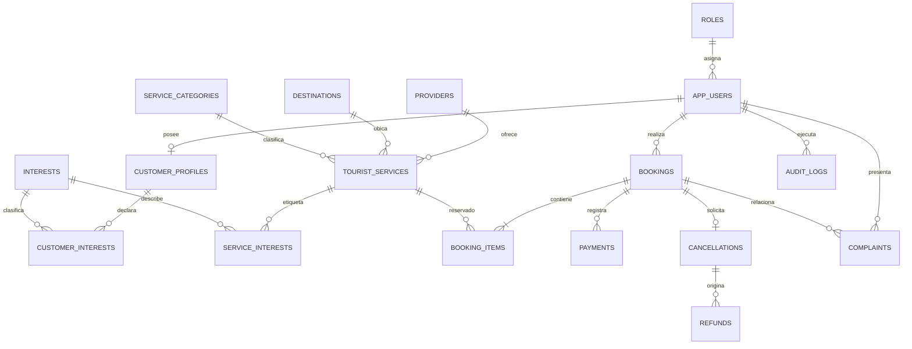

# Marco aplicativo — primera parte y planificación

## 1. Resultado de la revisión documental

Los tres documentos describen un prototipo académico de gestión turística inspirado en Booking.com, acotado a La Paz y construido con datos sintéticos. El núcleo verificable es: catálogo de alojamientos, experiencias y paquetes; preferencias de clientes; búsqueda y comparación; reservas e itinerarios simulados; pagos trazables sin pasarela real; cancelaciones, reembolsos y reclamos; recomendación basada en contenido; dashboard; predicción semanal experimental; roles, auditoría y respaldos.

Actores identificados en el diagrama: Cliente/Viajero, Administrador, Proveedor turístico, Personal de atención al cliente, Pasarela de pagos y Sistema de IA. En el prototipo, la pasarela y el sistema de IA son simulaciones o componentes internos, no integraciones productivas.

Restricciones principales:

- Prototipo en español, ejecutado localmente y sin disponibilidad continua.
- Catálogo objetivo de 60 servicios ficticios y 30 perfiles sintéticos.
- Hasta cinco sesiones simultáneas durante la demostración.
- No existen pagos, facturación fiscal, reservas ni ofertas reales.
- Esfuerzo máximo declarado: 180 horas conjuntas.
- Cinco iteraciones de dos semanas y una semana final de cierre.

### Hallazgos que deben corregirse en el documento académico

1. El apartado 2.5 selecciona React + NestJS + TypeORM + MySQL + Windows, mientras 2.8 describe Django + PostgreSQL + GNU/Linux. Se propone conservar el stack del apartado 2.5, porque allí se justifica formalmente cada tecnología, y reescribir 2.8 para que use NestJS, TypeORM y MySQL. Si el equipo prefiere Django/PostgreSQL, debe cambiar 2.5 antes de programar el backend.
2. El alcance formal habla de roles Administrador y Agente, pero el diagrama agrega Cliente, Proveedor y Soporte. Deben distinguirse los usuarios autenticables de los actores externos/simulados. La base inicial admite ADMIN, AGENT, CUSTOMER y SUPPORT; el proveedor se modela como entidad comercial.
3. En objetivos quedan marcas editoriales como “solucione(PERMITA)”, “Diseñar(DESARROLLAR)” y notas sueltas. Deben resolverse antes de entregar el capítulo.
4. El cronograma original termina el 25 de octubre de 2026. Como esa fecha ya pasó, debe presentarse como línea base ejecutada o reprogramarse; no debe redactarse como trabajo futuro sin aclaración.
5. El título alterna “agencia de viajes”, “Booking.com” y “gestión de vuelos”, aunque el alcance incluye alojamiento, experiencias y paquetes. Se recomienda el nombre consistente: **Sistema prototipo de gestión turística para una agencia de viajes de La Paz, inspirado en Booking.com**.

## 2. Organización Scrum adaptada

| Responsabilidad | Integrante | Función práctica |
|---|---|---|
| Product Owner | Sheyla | Prioriza backlog, valida alcance, requisitos y modelos. |
| Scrum Master | Alexandra | Facilita planificación/revisión, registra bloqueos y cuida la adaptación Scrum. |
| Desarrollo e integración | Melani | Lidera backend, frontend e integración funcional. |
| Developers | Las tres | Construyen, prueban, revisan y documentan el incremento. |
| Especialista IA/datos | Alexandra | Recomendador, datos sintéticos, métricas y predicción. |
| Arquitectura/seguridad | Sheyla, con apoyo del equipo | UML, permisos, trazabilidad y controles. |

En un equipo de tres personas una integrante puede asumir una responsabilidad Scrum y también desarrollar. El docente es interesado/revisor, no Product Owner, salvo aceptación expresa.

## 3. Product backlog priorizado

| ID | Necesidad / historia resumida | Prioridad | Criterio de aceptación principal |
|---|---|---:|---|
| PB-01 | Entorno reproducible y arquitectura única | Alta | El proyecto se inicia desde instrucciones versionadas. |
| PB-02 | Acceso por roles | Alta | Cada rol solo accede a operaciones autorizadas. |
| PB-03 | Proveedores, destinos y catálogo | Alta | Se pueden registrar y filtrar servicios disponibles. |
| PB-04 | Clientes y preferencias | Alta | Presupuesto, duración e intereses quedan almacenados. |
| PB-05 | Buscar y comparar servicios | Alta | Filtra por destino, categoría, presupuesto y duración. |
| PB-06 | Reservas e itinerario simulados | Alta | Una reserva conserva detalle, importe y estado coherentes. |
| PB-07 | Pago simulado y trazabilidad | Alta | Cada transacción tiene referencia, monto y estado; no guarda datos de tarjeta. |
| PB-08 | Cancelación y reembolso | Alta | No se reembolsa más que el importe aprobado/pagado y queda auditoría. |
| PB-09 | Reclamos | Media | Cliente registra y soporte atiende con estado y resolución. |
| PB-10 | Recomendación basada en contenido | Alta | Devuelve hasta cinco opciones sin violar restricciones obligatorias y explica coincidencias. |
| PB-11 | Dashboard descriptivo | Media | Muestra reservas, estados, cancelaciones, importes y servicios solicitados. |
| PB-12 | Predicción semanal experimental | Baja | Genera una estimación reproducible y muestra sus límites. |
| PB-13 | Seguridad, auditoría y respaldo | Alta | Permisos se validan en servidor y una copia puede restaurarse. |
| PB-14 | Pruebas, UML, instalación y evidencias | Alta | Cada historia crítica tiene prueba/evidencia y documentación mínima. |

## 4. Planificación de sprints

La capacidad es de 30 horas conjuntas por sprint. Las fechas históricas del documento se incluyen como referencia; si el trabajo empieza ahora, deben sustituirse manteniendo la duración.

### Sprint 1 — Base verificable (10–23 de agosto; 30 h)

**Objetivo:** disponer de una base técnica reproducible y un modelo de datos coherente con el alcance.

**Backlog:** PB-01, inicio de PB-02, PB-03, PB-04 y PB-13.

**Plan:** cerrar la decisión tecnológica; crear repositorio y convenciones; levantar MySQL en Docker; construir modelo relacional; cargar roles, intereses, destinos, proveedores y servicios sintéticos mínimos; documentar instalación y verificación.

**Incremento:** base MySQL inicial ejecutable con Docker y consultas de comprobación. Es la parte implementada en esta entrega.

**Aceptación:** el contenedor pasa su healthcheck; las tablas se crean sin intervención manual; las claves foráneas y restricciones rechazan datos incoherentes; otra integrante puede seguir el README.

**Responsables:** Sheyla (modelo y validación), Melani (Docker/SQL), Alexandra (atributos de preferencias e intereses). Revisión conjunta.

### Sprint 2 — Catálogo, clientes y búsqueda (24 de agosto–6 de septiembre; 30 h)

**Objetivo:** permitir administrar y consultar el catálogo demostrativo según las preferencias del viajero.

**Backlog:** PB-02, PB-03, PB-04, PB-05 y parte de PB-14.

**Plan:** backend de autenticación y roles; CRUD de proveedores/servicios; importación o generación de 60 servicios; 30 perfiles sintéticos; filtros; primera interfaz React; pruebas de permisos y filtros.

**Incremento:** usuario autenticado consulta el catálogo y un administrador mantiene servicios.

**Aceptación:** no hay contraseñas en texto plano; filtros obligatorios funcionan; un usuario sin rol no modifica catálogo; los datos se identifican como sintéticos.

### Sprint 3 — Reserva y recomendación (7–20 de septiembre; 30 h)

**Objetivo:** completar el recorrido desde preferencias y búsqueda hasta una reserva simulada trazable.

**Backlog:** PB-06, PB-07, versión mínima de PB-08, PB-09 y PB-10.

**Plan:** estados y transiciones de reserva; detalle de itinerario; pago simulado; solicitud de cancelación/reembolso; reclamo básico; servicio de recomendación TF-IDF/similitud coseno; explicaciones por atributos coincidentes; pruebas de integración.

**Incremento:** el cliente obtiene hasta cinco recomendaciones y registra una reserva con pago simulado.

**Aceptación:** ninguna recomendación excede presupuesto/duración; el total de reserva coincide con sus ítems; no se exponen datos de otras reservas; cada cambio sensible genera auditoría.

### Sprint 4 — Analítica e integración (21 de septiembre–4 de octubre; 30 h)

**Objetivo:** convertir el historial sintético en información reproducible para decisión y evaluación.

**Backlog:** PB-11, PB-12, evaluación de PB-10 y parte de PB-14.

**Plan:** generar 156 semanas de historial; dashboard (10 h); predicción Poisson (12 h); integración y trazabilidad de versiones (8 h); métricas Precision@5, NDCG@5, cobertura, restricciones y p95.

**Incremento:** dashboard filtrable con analítica descriptiva, métricas del recomendador y predicción siguiente semana.

**Aceptación:** indicadores usan definiciones documentadas; no presentan importe como utilidad; evaluación final no contamina el ajuste; predicción conserva fecha de corte, parámetros y versión de datos.

### Sprint 5 — Seguridad y calidad (5–18 de octubre; 30 h)

**Objetivo:** demostrar que el incremento integrado satisface historias críticas y controles mínimos.

**Backlog:** cierre de PB-08, PB-09, PB-13 y PB-14.

**Plan:** completar flujos de reembolso/reclamo; probar acceso indebido, entradas inválidas y manipulación de importes; pruebas unitarias/integración; respaldo y restauración; corrección de defectos; revisión UML y manual.

**Incremento:** versión candidata para presentación con evidencias de pruebas funcionales, IA y seguridad.

**Aceptación:** cero defectos conocidos que impidan los recorridos críticos; permisos validados en backend; restauración exitosa en base separada; secretos fuera del repositorio; resultados reproducibles.

### Semana de cierre (19–25 de octubre; 12 h)

No incorpora funcionalidad nueva. Se congela alcance, se corrige documentación, se prepara instalación limpia, datos de demostración, presentación y defensa compartida.

## 5. Definiciones de trabajo

**Definition of Ready:** historia entendible, actor y valor definidos, criterios comprobables, dependencias conocidas, datos de prueba identificados y estimación compatible con la capacidad.

**Definition of Done:** código revisado e integrado; prueba correspondiente aprobada; permisos y validación en servidor; datos sintéticos etiquetados; documentación mínima actualizada; sin secretos; incremento demostrable desde una instalación limpia.

Ceremonias adaptadas: planificación al inicio (60 min), coordinación semanal (15 min), revisión con demostración al cierre (45 min) y retrospectiva (30 min). Los bloqueos y decisiones se registran en el repositorio.

## 6. Diseño inicial implementado

Las tablas físicas se encuentran en `database/init/001_schema.sql`. La primera versión incluye integridad referencial, validaciones de importes/duración/capacidad, índices de búsqueda, trazabilidad y datos de catálogo mínimos. No almacena números de tarjeta ni integra una pasarela real.

## 7. Modelos que debe producir el marco aplicativo

| Modelo requerido | Entrega propuesta | Sprint |
|---|---|---:|
| Conceptual UML | Clases Usuario, Rol, Cliente, Preferencia, Proveedor, Servicio, Reserva, Pago, Cancelación, Reembolso y Reclamo | 1–2 |
| Navegación UML | Mapa por rol: acceso → búsqueda → detalle → recomendación → reserva → estado/reclamo; administración → catálogo/reportes | 2 |
| Presentación UML | Wireframes de acceso, buscador, resultados, detalle, reserva, estado, reclamo y dashboard | 2–4 |
| Procesos UML | Actividades de reserva/pago y cancelación/reembolso con caminos de error | 3 |
| Implementación | Arquitectura cliente–API REST–MySQL y diagrama de despliegue Docker | 1–2 |
| Base de datos | ER, modelo relacional, diccionario, restricciones y estrategia de respaldo | 1 y 5 |

## 8. Próximo paso inmediato

Con Docker Desktop iniciado, ejecutar y verificar esta base. Después, antes de abrir Sprint 2, aprobar por escrito la decisión NestJS/MySQL o migrar coherentemente todo a Django/PostgreSQL. La primera historia de backend debe ser autenticación/roles y no el recomendador: así el control de acceso se diseña desde el inicio y los módulos siguientes heredan una base segura.
